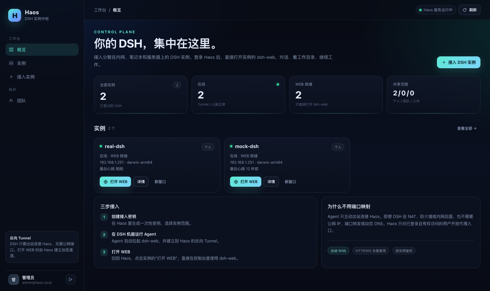
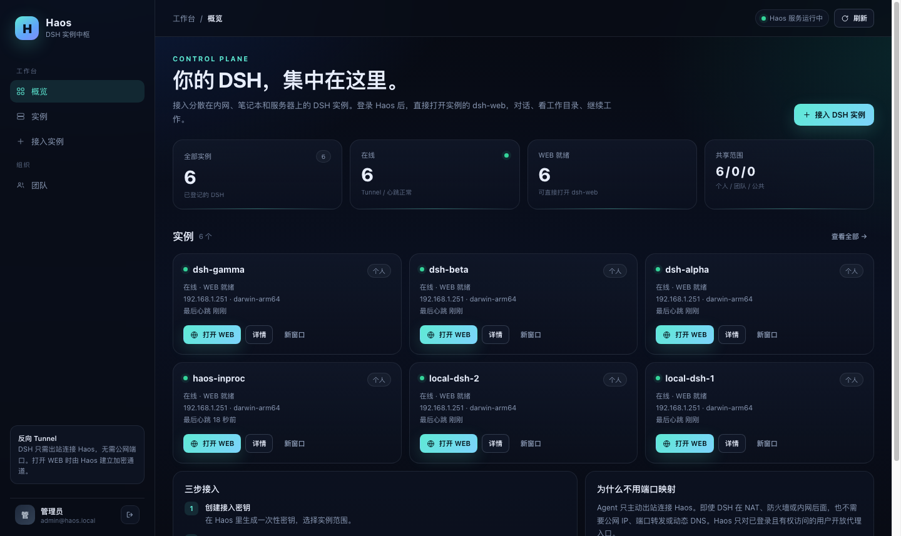

# Haos

> 通过 DSH 插件把 web / desktop / headless 的 DSH 实例接入 Haos；需要时可在 Haos 内直接打开 `dsh-web`。

**状态：可运行原型。** 插件是唯一的接入方式，已删除 sidecar/Agent 模式。



## 架构

> 组织与任务转发（中心化 co-dsh）的设计与 API 见 [docs/org-relay.md](docs/org-relay.md)。

```text
DSH（web / desktop / headless）
  └─ dsh-haos 插件（进程内）
       ├─ 用用户级 API Key 注册实例
       ├─ 心跳 / 控制 WSS
       ├─ session/event、工具事件
       ├─ haos-home 工作区
       └─ 如果 profile 有 dsh-web：
            复用当前 web server + 内嵌 Tunnel → Haos /w/:instanceId/

Haos
  ├─ 实例目录 / 控制 Hub / 事件
  ├─ Tunnel Hub / WEB Gateway
  └─ 浏览器控制台
```

- **插件必需**：所有 DSH 模式都通过 `dsh-haos` 接入。
- **dsh-web 可选**：只有需要在 Haos 中打开 DSH 页面时，profile 才需要 `@deepseek-ai/dsh-web-app`。
- **没有 sidecar**：不存在 `haos-agent` 进程，也不需要额外拉起 dsh-web。
- **一个 API Key**：用户级密钥可被多台 DSH 实例复用，不是每台实例一个密钥。
- **实例名由 Haos 分配**：`dsh-0001`、`dsh-0002`…，插件/客户端不能自选。
- **haos-home**：插件启动后自动在 DSH 中创建 `haos-home` 工作区；Haos 后续工作区放在这个父目录下。
- **组织管理**：团队创建/改名/删除、成员与角色（owner/admin/member）、组织名称/级联深度；
- **组织与委派**：同一团队/用户的实例组成一棵组织树，树在控制台集中配置；
  任务经 Haos 转发（`relay_tasks`），由中心校验“直接下级 / 防环 / 深度”。
  插件提供 `haos_org`、`haos_delegate`、`haos_task` 三个工具，并把收到的任务
  在本机用独立 DSH 会话执行后回写结果。详见 [docs/org-relay.md](docs/org-relay.md)。

## 快速开始

### 1. 启动 Haos

```bash
cd haos
pnpm install
pnpm start
# http://127.0.0.1:4600
```

### 2. 创建一个用户级 API Key

打开 **接入实例 → 创建 API Key**。密钥只显示一次，可被多台 DSH 复用。

### 3. 在已有 DSH 上安装插件

在 Haos 仓库根目录：

```bash
node scripts/install-dsh-plugin.mjs \
  --profile desktop \
  --base http://<haos-host>:4600 \
  --api-key 'haos_api_...' \
  --workspace "$HOME/.haos/workspace"
```

- `desktop`：DSH 桌面应用；
- `web`：`dsh --profile web` 的 Web 实例；
- 其他 profile：传对应 `--profile` 名称。

脚本会安装 `dsh-haos`、写入配置，不创建新 profile，不启动 Agent。

### 4. 重启 DSH

- 桌面应用：退出后重新打开；
- Web：重启 `dsh --profile web`；
- headless：重启对应 DSH 进程。

实例会自动出现在 Haos；如果有 dsh-web，状态为 **WEB 就绪**。

## 三种 DSH 模式

| 模式 | 接入 Haos | 在 Haos 中打开页面 |
| --- | --- | --- |
| `desktop` | 插件进程内注册 | profile 含 `dsh-web-app` 时可打开 |
| `web` | 插件进程内注册 | 可以，复用当前 web server |
| `headless` | 插件进程内注册 | 没有 UI；除非额外提供 dsh-web |

插件会在 DSH 进程内：

- 注册实例、心跳；
- 建立控制 WSS；
- 订阅 `session/event`；
- 提供 `haos_instance_info / haos_notify / haos_report / haos_workspace` 工具；
- 创建 `haos-home` 工作区；
- 在当前 profile 有 web server 时认证并建立反向 Tunnel。

## API Key 与实例身份

- API Key 属于用户，可复用；不是一次性 enrollment key。
- 每个 DSH 实例在 `haos-home/.haos/instance.json` 持久化一个 `clientInstanceId`。
- 服务端按 `owner + clientInstanceId` 复用实例；DSH 重启后不会变成新实例。
- 服务端仍分配 `dsh-XXXX` 作为稳定名称。
- 插件可设置 `friendlyName`，服务端管理员可设置显示名；优先级：**服务端显示名 > 客户端友好名 > 服务端名称**。
- 插件上报 `hostIp / processUser / pid / startedAt / profile / dshHome`，用于管理员区分同主机多实例。
- 每个实例使用独立的 `haos-home`；插件用 `.haos/lock` 原子锁阻止多个 DSH 同时占用同一个目录。
- **`haos-home` 受保护**：Host 会拒绝删除请求，DSH UI 中执行删除会报错。
- 插件设置页在 **设置 → Haos**，可修改 Haos 地址、API Key、友好名、工作区，并支持“测试连接”。配置按卡片显式保存，不做自动保存。

## 当前本机演示

所有实例均为插件模式，没有 sidecar：

| 实例 | 模式 | 说明 |
| --- | --- | --- |
| `haos-inproc` | 插件 | 独立 `haos` profile |
| `dsh-alpha` / `dsh-beta` / `dsh-gamma` | 插件 | 三个独立 DSH_HOME/工作区 |
| `dsh-0005` | 插件 | 原普通 `web` profile 直接安装插件 |
| `dsh-0008` | 插件 | 使用 API Key 安装的现有 web profile |



## 目录

```text
haos/
├── server/                  # 控制面（Node + node:sqlite + ws）
│   └─ src/
│       ├── main.mjs         # HTTP API + 静态站点
│       ├── tunnel-hub.mjs   # 反向 WSS、HTTP/WS 多路复用
│       ├── control-hub.mjs  # 控制 WSS、命令/事件
│       ├── web-gateway.mjs  # /w/:instanceId/ 代理
│       ├── auth.mjs         # 登录、API Key、实例令牌、权限
│       ├── instances.mjs    # 注册、心跳、实例视图
│       └─ db.mjs            # 表结构、种子数据
├── web/                     # 无构建前端
├── integrations/dsh-haos/   # 唯一的 DSH 接入插件
├── scripts/
│   ├── install-dsh-plugin.mjs
│   ├── create-haos-profile.mjs
│   └── mock-dsh-web.mjs
├── docs/
│   ├── design.md
│   ├── control-channel.md
│   ├── haos-profile.md
│   └── screenshots/
└── data/                    # 运行时数据（gitignored）
```

## 安全

- `dsh-web` 默认只监听 `127.0.0.1`；Haos 通过出站 Tunnel 访问，不需要入站端口。
- Haos 仍是权限网关：个人 / 团队 / 公共范围决定谁能打开实例。
- 团队/公共实例共享同一个 DSH 进程、工作区和工具权限，不是用户级隔离。
- 当前原型默认 HTTP + 演示密码；不要直接暴露公网，生产需 TLS、强认证、限流和低权限运行。
- API Key 是长期密钥：只存放在 DSH 配置/环境变量中，Haos 只保存哈希。

## 文档

- [设计文档](docs/design.md)
- [控制通道协议](docs/control-channel.md)
- [Haos Profile](docs/haos-profile.md)
- [插件说明](integrations/dsh-haos/README.md)
